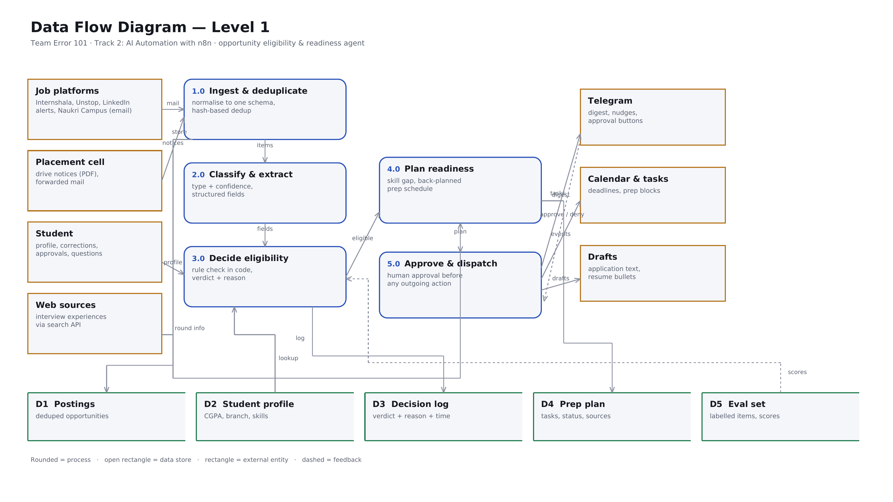

# Architecture

Team Error 101 · Track 2: AI Automation with n8n



## Design rules

1. **The model extracts; code decides.** Classification and field extraction are LLM work.
   Deduplication, eligibility comparison and conflict resolution are Code nodes. Numeric comparison
   and auditability are exactly what a language model is worst at.
2. **Nothing leaves without approval.** Every outgoing action — a sent application, a calendar write,
   a drafted reply — passes a Telegram approval step first.
3. **Every decision carries a reason.** One row per decision in the log: item, verdict, reason,
   timestamp. This is what makes the system defensible rather than magical.
4. **Untrusted input is screened.** Email arrives from strangers and the agent holds tools, so text
   passes a Guardrails check before it reaches any prompt, and extracted text never enters the system
   prompt.
5. **Degrade, don't crash.** Retry On Fail plus On Error continue on every external call, with an
   error workflow that reports failures to Telegram.

## Processes

### 1.0 Ingest and deduplicate

Sources: IMAP/Gmail for alert mail, forwarded placement mail, and PDF notices through Extract From
File. One alert email often contains several postings, so a Split Out step fans them into separate
items before anything else.

Dedup key: a SHA-256 hash over normalised `sender + subject + date`. Stored in D1; a repeat hash is
dropped. Deterministic, explainable, and immune to prompt drift.

### 2.0 Classify and extract

A classifier assigns a type (opportunity, deadline, noise) and the Information Extractor pulls a
fixed schema:

```json
{
  "company": "string",
  "role": "string",
  "cgpa_min": "number | null",
  "branches": ["string"],
  "batch_year": "number | null",
  "backlogs_allowed": "number | null",
  "deadline": "ISO-8601 date | null",
  "apply_link": "string | null"
}
```

Any field not stated in the source must come back `null`. A verification step then checks that each
extracted number actually appears in the source text; if it does not, the item is routed to the
review queue rather than trusted. This kills the most dangerous failure mode, where the JSON is valid
but a cutoff was invented.

Uncertainty is detected by **disagreement**, not by the model's own confidence score: a keyword rule
check runs alongside the classifier, and anything the two disagree on goes to review. Self-reported
LLM confidence is poorly calibrated and makes a bad gate.

### 3.0 Decide eligibility

A Code node compares the extracted criteria against the student profile in D2 and returns one of
`eligible`, `not_eligible`, `ambiguous`, each with a human-readable reason. See
`workflows/01-skeleton.json` for the implementation.

### 4.0 Plan readiness

For eligible openings: diff the role's requirements against the profile's skills, mark each gap
`close`, `reachable`, or `not reachable` before the deadline, then back-plan sessions from the
deadline into free timetable slots. Tasks are written to D4 and to Google Calendar.

Round-structure information is retrieved through a search API, kept only when two independent sources
agree, and stored with its source URLs. Anything single-sourced is labelled as such.

### 5.0 Approve and dispatch

Telegram send-and-wait. Approve and the tool runs; deny and the agent is told, and both outcomes are
logged. Because n8n builds the callback URL from the instance address, the instance must be reachable
publicly (`WEBHOOK_URL` set, tunnel or VPS) — on localhost the approval button is rejected.

## Data stores

| Store | Contents |
|---|---|
| D1 Postings | deduplicated opportunities with their hash and source |
| D2 Student profile | CGPA, branch, batch, backlogs, skills, timetable free slots |
| D3 Decision log | one row per decision: item, verdict, reason, timestamp |
| D4 Prep plan | tasks with status, due date and source citations |
| D5 Eval set | hand-labelled items and the scores from each evaluation run |

## Measurement

30 hand-labelled items, scored with n8n's evaluation feature. Two numbers are reported: classification
accuracy, and agreement between the eligibility engine and manual checking. The labelled set is built
from publicly published placement notices; any augmented items are marked as augmented.

## Known risks

| Risk | Mitigation |
|---|---|
| Gmail OAuth refresh tokens expire after 7 days while the Google app is in Testing | use IMAP with an app password for ingestion |
| Telegram approval URL points at localhost | public `WEBHOOK_URL` via tunnel or VPS, tested before the event |
| Free-tier LLM quota exhausted mid-demo | caching, a cheaper model for classification, and a fallback provider branch |
| Scanned PDF notices yield no text | OCR path, or fall back to the email body |
| Prompt injection inside an email | Guardrails screening, extracted text kept out of the system prompt, approval on all actions |
